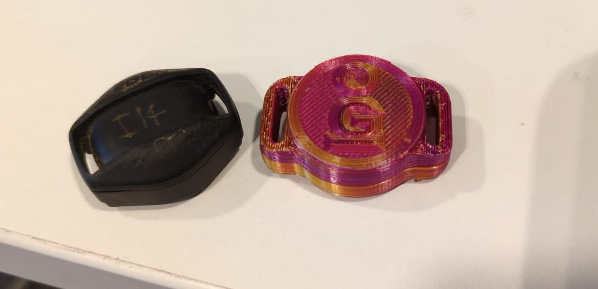

# JillTrak

A replacement collar transmitter for Deben ferret finders. It works with the
Deben receivers people already have.

Lots of ferreters use Deben finders. The collar goes on the ferret, and the
handheld receiver tells you where it is underground and how deep. Deben has
closed down and you can't buy new collars any more, so if you lose one down a
hole, that's it. We measured a working Deben collar, built our own to match it,
and put everything here so anyone can make one.

*An original Deben collar (left) and one of ours (right).*

If you'd like us to make one for you, email natalia at galinengine dot com.
They cost about US$200.

If you want to support the project, you can [donate here](DONATE.md).

## Where it's at (October 2026)

Our transmitter matches the Deben's signal. We recorded both side by side with
an SDR: same frequency (about 149.1 kHz), same burst length and spacing (11.1 ms
every 184 ms or so), and the signal strength is within about 1 dB.

One difference is that our signal fades slightly over each burst, while the
Deben's stays level. We're working on that in the firmware.

The circuit board works and is ready to order from JLCPCB. The firmware works
on two SR936 cells, and we're testing a new version that should run on a single
CR1632. The 3D-printed case works, but we're still fixing a few fit problems.

We haven't done proper range and depth tests with a Deben receiver yet.

> TODO (Natalia): add the receiver test results when you have them.

## What's in here

- [`background/`](background/): how the Deben works, how we measured it, and how ours compares
- [`Firmware/`](Firmware/): the ATtiny85 code, and how to flash and calibrate a board
- [`hardware/pcb/`](hardware/pcb/): the circuit board, with everything you need to order it
- [`hardware/enclosure/`](hardware/enclosure/): the case STLs, print settings and assembly steps
- [`docs/`](docs/): a one-page overview of the project
- [`tools/`](tools/): our SDR analysis scripts, and the sketch that turns an Arduino into a programmer

## Making your own

Order the board from JLCPCB using the files in [`hardware/pcb/`](hardware/pcb/),
and buy the reed switch and cells separately. Program it with an Arduino Uno
(see [`Firmware/`](Firmware/)), then print the case and put it together (see
[`hardware/enclosure/`](hardware/enclosure/)).

You'll need to be comfortable soldering tiny parts and fine wire, and flashing
firmware. You'll also need an SDR or a Deben receiver to check each board's
frequency.

## Licence

The firmware and tools are under the [MIT licence](LICENSES/MIT.txt), the
hardware under [CERN-OHL-P v2](LICENSES/CERN-OHL-P-2.0.txt), and the
documentation under [CC BY 4.0](LICENSES/CC-BY-4.0.txt). See
[LICENSE.md](LICENSE.md) for details.

We're not connected to Deben in any way. We only use the name to say what this
works with.
