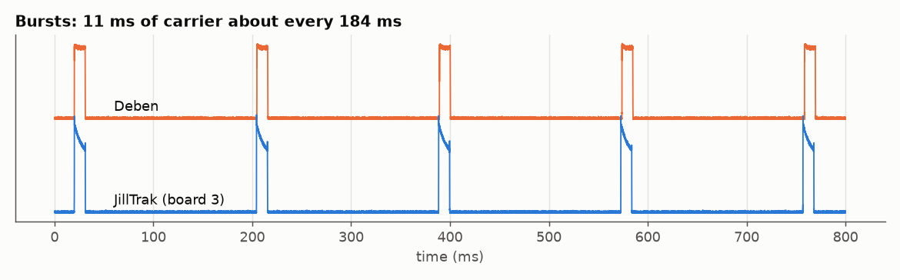
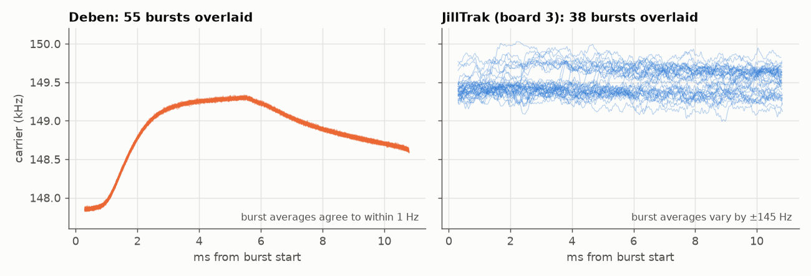
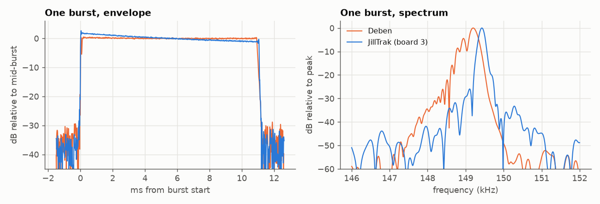
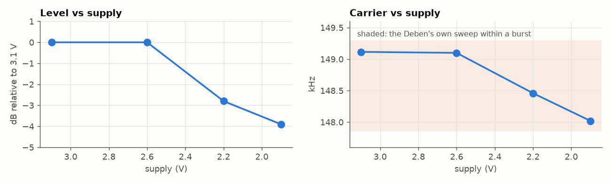

# Background

## Why we started this

Deben ferret finders have been around for years and a lot of ferreters use
them. A small transmitter goes on the ferret's collar, and a handheld receiver
tells you where the ferret is underground and how deep. Deben has since closed
down, so there are no new collars. If you lose one or it breaks, there's
nothing to replace it with, and a perfectly good receiver ends up in a drawer.

So we took a working Deben collar, measured everything we could about it, and
built our own to match. Everything we made is in this repo for anyone to use.

We have nothing to do with Deben. We only use the name to say what this works
with.

*An original Deben collar (left) and one of ours (right).*

## How we worked it out

We had a working Deben collar and receiver, and no documentation, so
everything here comes from measuring them.

We recorded the collar with a software-defined radio (SDR) tuned to 150 kHz,
then analysed the recordings with the scripts in [`tools/sdr/`](../tools/sdr/).
The scripts find the transmitter's signal and measure each burst: how long it
is, how often it comes, how strong it is and what frequency it's on. We
recorded our own boards the same way, with the collar and antenna in exactly
the same spot each time, so we could compare signal strength directly. That
matters a lot. The signal drops by about 18 dB every time you double the
distance, so moving the collar a few centimetres makes more difference than
most design changes.

> TODO (Natalia): which SDR hardware and antenna were used.

We photographed the Deben case on a 10 mm grid and measured the cell well,
thread and O-ring with calipers.

We also ran the Deben and our board side by side on the same cells, silver
oxide SR936 and alkaline LR936, to see how each one copes as the cells run down.

## What the Deben does

The Deben sends short bursts of a 149.1 kHz signal. Each burst lasts 11.1 ms,
and they come about every 184 ms, so roughly five a second. It runs on two
SR936 cells (3.1 V). The coil is wound on a ferrite tube (16.5 mm across,
8.5 mm long) and tuned to the same frequency as the signal. The case is two
threaded halves with slots for the strap, about 30 × 36 mm and 15 mm thick,
sealed with an O-ring.

At 149 kHz the receiver isn't really picking up radio waves. At burrow
distances it picks up the coil's magnetic field directly, a bit like a metal
detector. Soil and rock hardly affect it. The field gets weaker with the cube
of the distance, and that's how the receiver can work out depth: if every
collar puts out the same strength, a given reading means a given distance.

One surprise was that the Deben's frequency isn't fixed. During each burst it
starts around 147.9 kHz, climbs to 149.3 kHz and drifts back down to 148.7 kHz.
It does exactly the same thing every burst, to within 1 Hz.

That tells us a few things. The signal probably comes from a simple analog
oscillator that starts fresh each burst. A crystal would hold one frequency,
and a microcontroller (like ours) wanders a little from burst to burst. It also
means the receiver has to accept at least that 1.4 kHz range, so our frequency
doesn't need to match the Deben's exactly.

When we ran it on alkaline cells for a couple of hours, the Deben's bursts got
2.3 % shorter and came 1.3 % closer together, while its frequency and strength
barely moved. That kind of timing drift is typical of a 555 timer chip, so our
best guess is that the Deben is built around 555s or something similar. We
haven't opened one up to check.

The Deben's signal is also a bit cleaner than ours, with less energy at
multiples of the main frequency. The receiver doesn't seem to care.

## How ours compares

| | Deben | JillTrak |
|---|---|---|
| Frequency | about 149.1 kHz, sweeps within each burst | about 149.1 kHz, set for each board |
| Burst-to-burst steadiness | the same every time | wanders by 40 to 150 Hz, depending on the chip |
| Bursts | 11.1 ms, every 184 ms or so | 11.1 ms, every 184 to 192 ms depending on the chip |
| Signal strength | | within about 1 dB of the Deben, side by side |
| Strength during a burst | stays level | fades by up to about 3 dB on alkaline cells (we're working on this) |
| Coil | ferrite tube | 19 turns of fine wire on a 23 mm printed former, no ferrite |
| On and off | magnet | magnet over a reed switch, one swipe on, one swipe off |
| Cells | two SR936 | two SR936 for now, a single CR1632 under test |

We skipped the ferrite because the right size of ferrite tube is very hard to
find. A wider coil and a stronger drive make up the difference.

The [firmware README](../Firmware/README.md) has the details on timing and
calibration.

### Keeping the signal level during a burst

The Deben's signal stays the same strength from the start of a burst to the
end. Ours starts a bit stronger and fades as the cells sag under the load, by
about 1 dB on a bench supply and up to 3 dB on alkaline cells. The firmware now
has an option to start each burst with a slightly weaker drive and build it up,
so the level stays flat. We're still tuning it.

## What we learned about cells

Two SR936 silver oxide cells work best electrically, and they're what the Deben
uses. Their voltage stays steady for most of their life. The downside is that
two small cells side by side are fiddly to fit in the case.

Alkaline LR936 cells have the least capacity, don't like the cold, and their
voltage drops steadily. Our earlier boards lost signal strength faster on these
than the Deben did.

A single CR1632 lithium cell would make the case much simpler and has the most
capacity. The problem is that it can't deliver the burst current without its
voltage dipping, and our first board on one started resetting mid-burst after a
few hours. The new firmware keeps going right down to 1.9 V, which should fix
that, and we're testing it now. On a bench supply the signal strength holds
steady down to 2.6 V and is about 4 dB lower at 1.9 V. The frequency stays
inside the Deben's own range the whole way.

## Still to do

- Range and depth tests with a Deben receiver, with our collar and a Deben side by side.
- Finish the CR1632 test.
- Keep the signal level through each burst, like the Deben.

> TODO (Natalia): anything else about where the Deben came from and who uses it.
