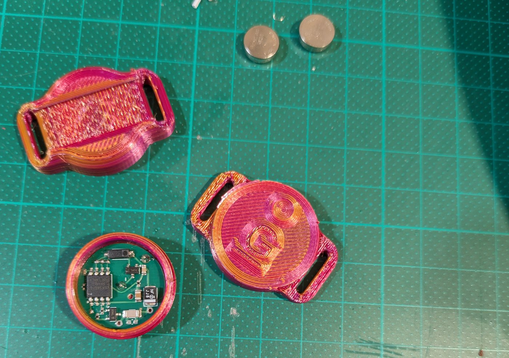
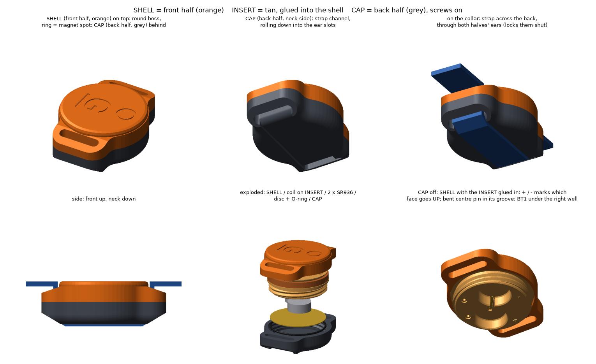
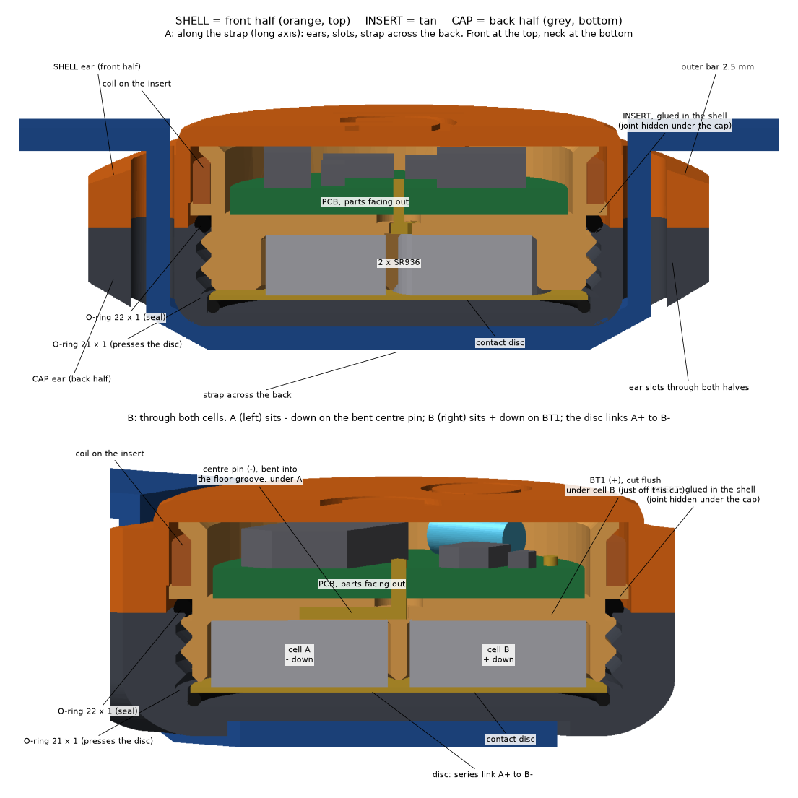

# JillTrak enclosure

A 3D-printed, O-ring sealed case in the Deben's style: two halves with strap
ears that screw together, with the strap running across the back through both
pairs of ears so the case cannot unscrew on the ferret. This version holds two
SR936 cells side by side, the same cells as the Deben. About 27 × 37 mm and
12.8 mm thick.

> **Work in progress.** This is design v11. Known issues are listed at the end,
> and the cell arrangement may change if the single-CR1632 test passes (see the
> [firmware README](../../Firmware/README.md)).



*Printed parts in PLA on a 10 mm grid: the CAP with its strap channel (top left), the SHELL with the logo and magnet ring (right), the INSERT with the board fitted (bottom left), and two SR936 cells.*



## The parts

| Part | File | What it is |
|---|---|---|
| **SHELL** | `stl/shell.stl` | the front half (away from the ferret). Holds the board, with the reed switch under the engraved ring, and the logo. |
| **INSERT** | `stl/insert.stl` | glued into the shell. Carries the coil former, the floor under the board, the two cell wells and the male thread. |
| **CAP** | `stl/cap.stl` | the back half (against the neck). Screws onto the insert and holds the contact disc. The strap runs across its back. |



## You will need

| Item | Notes |
|---|---|
| a programmed [tx-kick board](../pcb/) with its reed switch fitted | |
| about 2 m of 0.31 mm solderable enamelled copper wire | for the coil |
| 2 × SR936 cells (SR936SW, 9.5 × 3.6 mm) | |
| 1 × O-ring **22 × 1 mm** (ID × cross-section) | seals the thread |
| 1 × O-ring **21 × 1 mm** | presses the contact disc onto the cells |
| 1 × contact disc, **22.4 mm diameter, 0.3 mm** brass or copper | links the two cells in series |
| a short straight pin or 0.8 mm wire | BT1, the + pin |
| glue | for the insert into the shell, the disc and O-ring into the cap, and the coil leads |
| strap, up to 12 mm wide and 2 mm thick | the ear slots are 13 × 2.6 mm |
| a magnet | to switch the transmitter on and off |

> TODO (Natalia): which glue, which magnet, where the disc comes from, and the
> strap you use.

## Printing

Printed in PLA on a Creality Ender-3 Max Neo, sliced in Cura. The Cura profile
is [`JillTrak_PLA.curaprofile`](JillTrak_PLA.curaprofile): 0.16 mm layers,
3 walls, 20 % gyroid infill, 205 °C, bed at 60 °C, supports at 55°, 5 mm brim.

| Part | Orientation (as the STL is saved) |
|---|---|
| SHELL | front face down |
| INSERT | rim down. Printing it the other way up leaves supports that can't be removed, and the thin walls snap. |
| CAP | back face down |

Before gluing anything, screw the cap onto the insert to check the thread. When
the cap is fully home the ears should line up. If they stop short, the thread's
timing can be adjusted with `THREAD_PHASE` in `enclosure.py`.

## Assembly

> TODO (Natalia): check these steps and add photos.

1. **Wind the coil** on the insert's former. Take the start lead through the
   hole at the flange end of the former and down the groove in the bore. Wind
   about 19 turns in three layers (7, 7, 5). Bring the finish lead out through
   the slit in the lip.
2. **Fit the board** into the insert, component side out, so the battery pins
   and coil holes line up with the holes in the insert floor. Push it **fully
   home** and keep it level; a board sitting high on one side makes the cap sit
   crooked later.
3. **Coil leads:** take each lead through its pad hole (L1, L2) and on through
   the 0.9 mm hole in the floor to the cell side. Pull it taut, solder it at the
   pad, then trim it at the rim and glue it down.
4. **Battery pins:**
   - BT1 (+) comes straight up through the floor under the right-hand well. Cut it flush with the well floor.
   - The centre pin (−) is bent over into the groove in the floor, so it ends under the centre of the left-hand well.
5. **Glue the insert into the shell,** with the reed under the engraved ring.
   Check it sits square before the glue sets.
6. **Seal O-ring:** stretch the 22 × 1 O-ring over the insert's thread and down
   into its groove against the flange.
7. **Cap:** press the 21 × 1 O-ring into the cap's bore, then the contact disc on
   top of it. Glue both in, so they come away with the cap when you change the
   cells.
8. **Cells:** the left cell goes in **− side down** (onto the centre pin), the
   right cell **+ side down** (onto BT1). The + and − marks on the floor show
   which face goes up.
9. **Screw the cap on,** about one turn, until the ears line up. Then thread the
   strap down through one pair of ears, across the back, and up through the
   other pair.
10. **Switch on** by holding the magnet over the ring for a moment; do the same to switch off.

## Known issues (v11)

- **Cell fit.** A cell that is slightly loose can tilt and short its own + and −
  against the centre pin; one that is too tight is hard to fit. The fit depends
  on your printer. A strip of Kapton tape over the centre-pin groove is a
  stop-gap. The next version reroutes the centre pin under the floor.
- **The thread is shallow** (about 0.3 mm of engagement). It holds, with the
  strap's help, but a coarser and deeper thread is planned.
- **The insert is glued in,** so the board cannot be removed afterwards. Do all
  programming and testing first. A removable insert, clamped by the cap, is
  being considered.

## Changing the design

[`enclosure.py`](enclosure.py) is the CadQuery script that makes all three STLs.
The print fits are set at the top: cell clearance, board clearance, glue gap,
thread clearance. Run it with Python and [CadQuery](https://cadquery.readthedocs.io) 2.x:

```
python enclosure.py      # writes stl/shell.stl, stl/insert.stl, stl/cap.stl
```

The logo uses the Liberation Sans font; set `LOGO_FONT` if yours is elsewhere.
