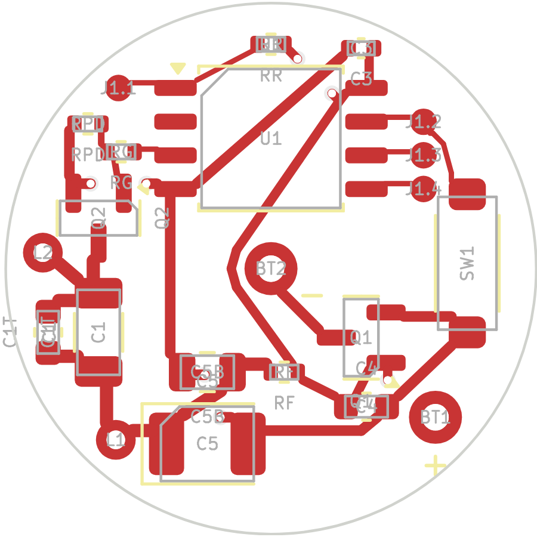
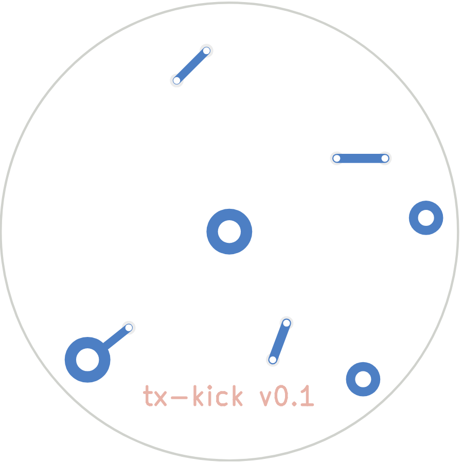

# tx-kick: the JillTrak circuit board

A 20 mm round, two-layer board with an ATtiny85, a MOSFET "kick" drive into a
tuned coil, a reed switch, and two pins that take power from the cells.
Several boards have been built and work; one has been run side by side with a
Deben on the same cells.

| Top | Bottom |
|---|---|
|  |  |

Schematic: [`tx-kick/tx-kick-schematic.pdf`](tx-kick/tx-kick-schematic.pdf).

## Getting boards made

Everything JLCPCB needs is in [`tx-kick/`](tx-kick/):

| File | Use |
|---|---|
| `tx-kick-gerbers.zip` | the bare board: copper, mask, paste, silkscreen, outline and drill (upload this first) |
| `tx-kick_bom_jlc.xlsx` (`.csv`) | bill of materials with JLCPCB/LCSC part numbers |
| `tx-kick_cpl_jlc.xlsx` (`.csv`) | placement file: part positions and rotations |
| `digikey_order.csv` | the parts JLCPCB does not fit (reed switch, tank trim capacitors) |

1. Upload `tx-kick-gerbers.zip` at jlcpcb.com. Two layers, **1.6 mm** thick (the case is designed around it), any colour.
2. Turn on **PCB Assembly**, top side. Upload the BOM and placement files.
3. **Check the rotations** in JLCPCB's placement preview before confirming. KiCad and
   JLCPCB's part libraries don't always agree on a part's zero rotation, most often for
   SOT-23 and SOIC parts.
4. **C1 must be C0G/NP0** (it sets the tuning). If the matcher offers an X7R part, reject it.

> TODO (Natalia): the exact JLCPCB options you used (panel or single boards,
> board thickness, quantity), and what the order cost.

## Parts fitted by hand

| Part | What | Notes |
|---|---|---|
| SW1 | Standex-Meder MK24-B-2 reed switch | Fit it **after** programming: it shares the SCK pin (PB2). |
| BT1 | + battery pin, 1.0 mm hole | straight pin or 0.8 mm wire, up through the insert floor |
| BT2 | − battery pin, 1.0 mm hole, centre | |
| L1, L2 | coil ends, 0.7 mm holes | see the coil below |
| C1T | tank trim, 0603 C0G | only if the coil needs tuning down: 1 nF lowers the carrier about 0.5 %, 4.7 nF about 2.3 % |

## The coil

About **19 turns of 0.31 mm enamelled copper wire** in three layers (7, 7, 5),
wound on the printed insert's former, about 23 mm across. With C1 (100 nF) it
tunes to about 149 kHz. Use **solderable polyurethane enamel** (IEC 60317-20 or
-51, sold as "solderable" or "self-fluxing" magnet wire); the iron at 380 to
400 °C strips it as you solder. Ordinary polyester or polyimide enamel has to be
scraped, which is very hard to do on a coil this small.

The coil leads pass through the L1 and L2 holes, through the insert floor, and
are soldered from the cell side. See [the enclosure README](../enclosure/).

## Programming

Four pads: J1.1 to J1.4 are RST (left of the chip), then SCK, MISO and MOSI
(right of the chip, top to bottom). Power comes through the two battery pins.
Wiring and the bring-up order are in the [firmware README](../../Firmware/README.md).
Tack the wires on with strain relief (tape them to the board) and remove them as
soon as programming is done. Loose wires tear the small pads off.

## How the board is made

The layout is generated by Python scripts, not drawn by hand, so it can be
checked and rebuilt:

| File | Role |
|---|---|
| `build_kick.py` | the circuit (netlist), part placement, silkscreen, BOM; writes `tx-kick/tx-kick.kicad_pcb` |
| `router.py`, `route_kick.py`, `route_kick_lib.py` | two-layer router; writes the tracks to `routes_kick.py` |
| `verify_kick.py` | reads the saved board and checks every pin's net against the circuit |
| `check_board.py` | runs KiCad's DRC and renders both sides |
| `schematic_kick.py` | draws the schematic PDF |
| `fplib.py`, `collar.pretty/` | custom footprints: reed switch, battery pins, coil pads, programming pads |
| `fab_kick.py` | JLCPCB BOM, placement and gerber zip |
| `route_all.sh` | all of the above in one go |

```
cd hardware/pcb
python3 -m venv --system-site-packages .venv      # KiCad 7's pcbnew comes from the system
.venv/bin/pip install numpy scipy matplotlib openpyxl
./route_all.sh
```

Open `tx-kick/tx-kick.kicad_pro` in KiCad 7 to view the board. Hand edits made in
KiCad are overwritten if you rerun the scripts. There is no KiCad schematic file:
the netlist in `build_kick.py` is the schematic, and `schematic_kick.py` draws it.
